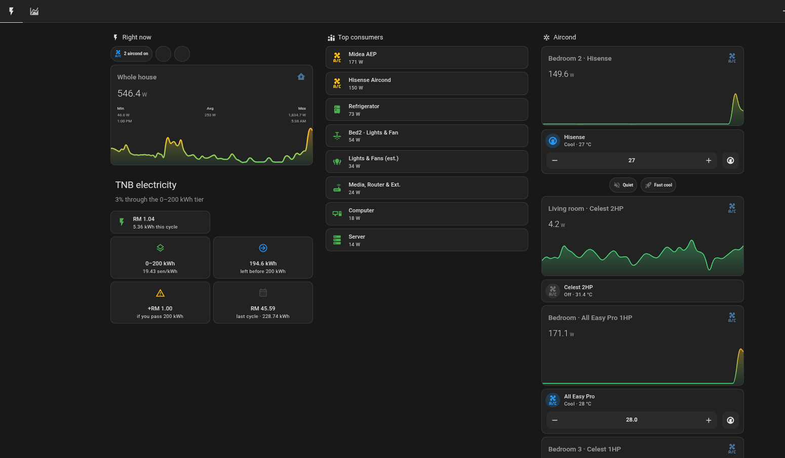

# ⚡ Home Energy & TNB Billing Dashboard (Home Assistant)

A clean, modern **Sections View** dashboard for Home Assistant focused heavily on **real-time power monitoring**, **device breakdowns**, and **Malaysia TNB (Tenaga Nasional Berhad) electricity tariff and tier calculations**.

---

## ✨ Features

- **TNB Tariff & Tier Calculator:** Automatically tracks your current monthly kWh usage against TNB block tiers, estimates your bill in Ringgit Malaysia (RM), calculates your percentage progress through the current tier, and warns you before you step into a higher rate bracket. Includes last cycle comparison!
- **Whole-House Real-Time Graph:** Live monitoring of your total home power load with dynamic color-coding based on consumption (Green = Idle/Low, Amber = Medium, Red = High).
- **Auto-Sorting Top Consumers:** Automatically lists your highest power-consuming devices in real-time.
- **Dedicated Zones:** Grouped cards for Air Conditioners (with climate controls and quick toggles), Kitchen appliances, Living Room electronics, and Bedroom setups.
- **Consistent Color Rules:** 
  - 🟢 **Green** = Low / Optimal
  - 🟡 **Amber** = Medium load
  - 🔴 **Red** = High load
  - ⚫ **Grey/Disabled** = Idle / Off

---

## 📦 Requirements & HACS Dependencies

Make sure you have the following **HACS frontend cards** installed before using this configuration:
- [Mushroom Cards](https://github.com/piitaya/lovelace-mushroom) (`custom:mushroom-...`)
- [mini-graph-card](https://github.com/kalkih/mini-graph-card) (`custom:mini-graph-card`)
- [auto-entities](https://github.com/thomasloven/lovelace-auto-entities) (`custom:auto-entities`)
- [apexcharts-card](https://github.com/RomRider/apexcharts-card) *(optional for advanced charts)*

*(Note: No `card-mod` is required!)*

---

## 🚀 Installation (Obviously won't work as is.. as this is personal sensors)

1. In your Home Assistant sidebar, go to **Settings** → **Dashboards** → **Add Dashboard** (give it a name, e.g., "Home Energy").
2. Open your newly created dashboard.
3. Click the three dots (`⋮`) in the top right corner → **Edit Dashboard**.
4. Click the three dots (`⋮`) again → **Raw configuration editor**.
5. Clear everything, paste the contents of `dashboard.yaml`, and click **Save**.
